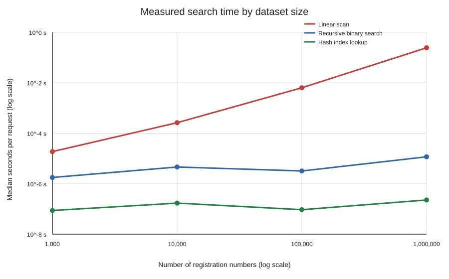

# Design, Analyse and Validate an Efficient Search Strategy

**Course:** CSA06 — Design and Analysis of Algorithms

**Assessment:** Assignment 1 — CO1 (50 marks)

**Student:** Mallapu Vidyadhar
**Source:** [Original seven-page assessment](Reference/MALLAPU%20VIDYADHAR%20-%20CO1%20ASSIGNMENT.pdf)

## Executive summary

This report compares iterative linear search, recursive binary search over a
sorted sequence, and lookup through a hash index. It derives their operation
counts and asymptotic bounds, solves the binary-search recurrence, and tests
implementations against generated unique registration numbers. The assessment
asks for 1,000, 10,000, 100,000, and 1,000,000-record datasets; measured
results and the generated CSV/SVG are included below in the Task 9 folder.

The recommended exact-key strategy is a hash index, subject to sufficient
memory and correct index maintenance. For the 50,000-searches-per-hour
challenge, the measured one-million-record serial estimate (hash build plus
50,000 expected lookups) was about 0.45 s on this run, versus 1.23 s for sort
plus binary searches and 12,275.56 s for linear scans. These estimates are
not production throughput claims: the benchmark uses synthetic identifiers,
single-process sequential timing, and does not model concurrent service,
database/network I/O, or full student records.

## Task-by-task answers

The complete answers are provided in the required order:

1. [Task 1 — Algorithm design](../Task_01_Algorithm_Design/answer.md)
2. [Task 2 — Basic operation](../Task_02_Basic_Operation/answer.md)
3. [Task 3 — Mathematical complexity](../Task_03_Mathematical_Complexity/answer.md)
4. [Task 4 — Best/average/worst cases](../Task_04_Case_Analysis/answer.md)
5. [Task 5 — Asymptotic analysis](../Task_05_Asymptotic_Analysis/answer.md)
6. [Task 6 — Recurrence formulation](../Task_06_Recurrence_Formulation/answer.md)
7. [Task 7 — Recurrence solution](../Task_07_Recurrence_Solution/answer.md)
8. [Task 8 — Implementation and tests](../Task_08_Implementation/answer.md)
9. [Task 9 — Experimental performance](../Task_09_Performance_Analysis/answer.md)
10. [Task 10 — Theory versus experiment](../Task_10_Theory_Experiment/answer.md)
11. [Task 11 — Final recommendation](../Task_11_Recommendation/answer.md)
12. [Task 12 — Day-4 design challenge](../Task_12_Design_Challenge/answer.md)

## Experimental results

The following are actual local measurements (rounded from
[performance.csv](../Task_09_Performance_Analysis/performance.csv)). The
experiment used the same deterministic shuffled dataset and 30 balanced
queries (15 hits and 15 misses) per size for each algorithm. Each measured
lookup time is the median of five rounds. Sorting and index construction are
timed separately. The generated plot is
[search_time.svg](../Task_09_Performance_Analysis/search_time.svg).

| Records | Linear scan (us/query) | Sort (s) | Recursive binary (us/query) | Hash build (s) | Hash lookup (us/query) |
|---:|---:|---:|---:|---:|---:|
| 1,000 | 18.73 | 0.000204 | 1.77 | 0.000097 | 0.087 |
| 10,000 | 262.24 | 0.002626 | 4.59 | 0.001172 | 0.170 |
| 100,000 | 6,353.66 | 0.047352 | 3.20 | 0.033795 | 0.093 |
| 1,000,000 | 245,511.11 | 0.645303 | 11.66 | 0.437719 | 0.227 |



At one million records, estimated serial times for 50,000 searches plus one
preprocessing pass are 12,275.56 s (linear), 1.23 s (sort and binary search),
and 0.45 s (hash build and lookup). These are projections from measured
per-query medians and preprocessing time, not a 50,000-request load test.
Intermediate measurements are not perfectly monotonic because short timing
samples are affected by the interpreter, cache, and host load; the theoretical
analysis predicts growth classes, not exact milliseconds.

## Reproducibility and manual verification

From the repository root, use Python 3.8 or newer:

```text
python -m unittest discover -s CO1_Assignment/Task_08_Implementation -p "test_*.py"
python CO1_Assignment/Task_08_Implementation/run_benchmark.py
```

The benchmark regenerates the CSV and SVG. No third-party dependencies are
required. The output- and source-code-screenshot folders are present but
intentionally contain instructions rather than fabricated images; capture
genuine screenshots in the intended submission environment if required.
See the [output screenshot folder](Screenshots/Output/README.md) and
[source-code screenshot folder](Screenshots/Source_Code/README.md).
Before submission, manually verify the student's name/identifier, course
formatting requirements, and whether screenshots or institution-specific
title-page details are mandatory.
